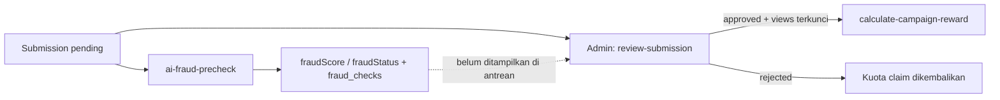

# Workflow: Campaign Submission — Fraud/Risk Precheck & Validasi Admin

> **Diverifikasi terhadap kode: 2026-10-12.** Sumber kebenaran:
> `00_BACKEND/functions/{submit-campaign-proof,ai-fraud-precheck,get-admin-submission-queue,review-submission,calculate-campaign-reward}`,
> `admin/src/features/admin/submissions/`, trigger di `00_BACKEND/appwrite.config.json`.

## Purpose

Memberi sinyal risiko otomatis untuk setiap bukti tayang Campaign tanpa mencampurnya dengan keputusan finansial final. `fraudStatus` adalah metadata; `submission.status` (diputus Admin Marketiv) adalah satu-satunya pemicu reward.

## Modules Involved

- [Campaigns](../02_Modules/Campaigns/00_Index.md) — `campaign_submissions`, `fraud_checks`, `campaign_claims`.
- [AI](../02_Modules/AI/00_Index.md) — analisis caption via Gemini, log `ai_requests`.
- [Payments](../02_Modules/Payments/00_Index.md) — reward setelah approve.
- [Notifications](../02_Modules/Notifications/00_Index.md) — notifikasi submission/penolakan/reward.

## Trigger

**Event `campaign_submissions.rows.*.create`**, yang terjadi setelah `submit-campaign-proof` membuat submission `pending`.

## Data Model — Collection yang Terlibat

| Collection | Aksi | Ditulis oleh |
|---|---|---|
| `campaign_submissions` | insert `pending`; update `fraudScore`, `fraudStatus`; update `status`, `views*`, `reviewNotes` | `submit-campaign-proof`, `ai-fraud-precheck`, `review-submission` |
| `fraud_checks` | insert `{ submissionId, score, result, reason }` (1 → N per submission) | `ai-fraud-precheck` |
| `ai_requests` | insert `{ userId, feature: "fraud", prompt, response }` | `ai-fraud-precheck` |
| `campaign_briefs` (env `CAMPAIGN_BRIEFS_COLLECTION_ID`, default `6ab530d00018edb50097` = `campaign_briefs_v2`) | read brief | `ai-fraud-precheck` |
| `campaign_claims` | update status mengikuti review | `review-submission` |

## Step-by-step Flow

### Tahap 1: Precheck Otomatis (`ai-fraud-precheck`, timeout 60 detik)

1. Muat submission (`postUrl`, `platform`, `caption`, `campaignId`).
2. Hitung skor risiko aditif:

   | Cek | Bobot |
   |---|---|
   | URL tidak valid (bukan `http`/`https`) | +30 |
   | Hostname tidak cocok platform (`tiktok.com`, `instagram.com`, `youtube.com`/`youtu.be`) | +20 |
   | URL tidak dapat diakses (GET non-2xx / error jaringan) | +25 |
   | `postUrl` duplikat dengan submission lain | +25 |
   | Analisis caption vs brief via Gemini `gemini-2.5-flash` (hanya bila `caption` ada **dan** `GEMINI_API_KEY` diset) | `floor(overallScore × 20 / 100)`, maks +20 |

3. `fraudScore = min(100, total)`; `fraudStatus`: `≤ 30 → safe`, `≤ 70 → review`, `> 70 → rejected`.
4. Tulis `fraudScore` + `fraudStatus` ke submission dan satu baris `fraud_checks` (alasan digabung `; `, atau "Lolos semua validasi").
5. **Tidak** mengubah `submission.status`.

> Update `fraudScore/fraudStatus` memicu event `campaign_submissions.rows.*.update` → `calculate-campaign-reward`, yang langsung berhenti karena status masih `pending`.

### Tahap 2: Validasi Admin

6. Admin membuka antrean `get-admin-submission-queue` (`status`: `pending|approved|rejected|all`, limit ≤ 100). DTO memuat kreator, campaign, UMKM, `postUrl`, caption, waktu submit, views terverifikasi, estimasi reward.
   - **Belum diimplementasikan:** DTO antrean dan admin app (`admin/src`) belum menampilkan `fraudScore`/`fraudStatus`/histori `fraud_checks`. Sinyal risiko saat ini tersimpan tetapi tidak dipakai untuk prioritas antrean.
7. Admin memanggil `review-submission`:
   - `approved` — wajib `views` (integer ≥ 0) dan hanya setelah `VIEW_VALIDATION_DELAY_HOURS` (default 72 jam) sejak submission dibuat; mengunci `views_count`, `views_captured_at`, `views_source: "manual_admin"`, `views_final: true`.
   - `rejected` — `reviewNotes` opsional; kuota claim dikembalikan (`totalClaims -= 1`); notifikasi `submission_rejected` ke kreator.
   - Claim diselaraskan ke status yang sama.
8. Approve → event update memicu `calculate-campaign-reward` (lihat [20_Campaign_PPV](20_Campaign_PPV.md) Tahap 8).

## Separation of Concerns



## State Transitions

```text
SUBMISSION.status:      pending → approved | rejected      (hanya review-submission)
SUBMISSION.fraudStatus: (kosong) → safe | review | rejected (hanya ai-fraud-precheck, sekali per create)
CLAIM.status:           submitted → approved | rejected     (mengikuti review)
```

## Events / Functions

| Trigger | Function | Aksi |
|---|---|---|
| HTTP (Creator) | `submit-campaign-proof` | Buat submission `pending`, claim `submitted` |
| `campaign_submissions.rows.*.create` | `ai-fraud-precheck` | Skor risiko + `fraud_checks` |
| HTTP (Admin) | `get-admin-submission-queue` | Antrean review |
| HTTP (Admin) | `review-submission` | Keputusan final + views terkunci |
| `campaign_submissions.rows.*.update` | `calculate-campaign-reward` | Reward bila `approved` |

## Validation Rules per Langkah

| Langkah | Validasi | Gagal → |
|---|---|---|
| Precheck | `submissionId` ada | 400 |
| Antrean | Caller Admin aktif (lihat catatan otorisasi) | 403 |
| Review | Submission `pending`; status `approved|rejected` | 409 / 400 |
| Approve | `views` integer ≥ 0; periode observasi selesai | 400 / 409 (+`eligibleAt`) |

Otorisasi Admin (`review-submission`, `get-admin-submission-queue`): baris `users.role = "admin"` + `status = active`, atau fallback akun Auth dengan label `admin` **atau** `prefs.role = "admin"`.

## Notifikasi

| Titik | Kind | Penerima | Ditulis oleh |
|---|---|---|---|
| Bukti dikirim | `submission` | UMKM | `submit-campaign-proof` |
| Ditolak | `submission_rejected` | Kreator | `review-submission` |
| Reward | `reward` | Kreator | `calculate-campaign-reward` |
| Hasil precheck | Tidak ada notifikasi (sengaja; skor tidak ditampilkan sebagai tuduhan) | — | — |

## Presentasi ke Creator/UMKM

- Skor AI mentah tidak ditampilkan sebagai tuduhan. Status `Ditolak` hanya dirender bila `submission.status = rejected`.
- Dashboard UMKM menghitung submission dengan `fraudStatus` ≠ `safe` sebagai kategori "dispute" (`src/services/umkm/umkm-appwrite.service.ts`) — label UI, bukan fitur sengketa.
- Banding atas submission yang ditolak: lewat WhatsApp Admin (lihat [60_Dispute](60_Dispute.md)); tidak ada alur banding submission di platform.

## Edge Cases

- Precheck gagal/timeout → submission tetap `pending` tanpa skor; Admin tetap dapat memutus. Kegagalan hanya terlihat di log Function.
- Caption kosong atau `GEMINI_API_KEY` tidak diset → analisis konten dilewati (dicatat di `reason`).
- Respons Gemini tidak bisa di-parse → dianggap `overallScore = 50` (+10 risiko).
- URL duplikat terdeteksi di semua campaign, bukan hanya campaign yang sama.
- Precheck hanya berjalan sekali (event create); tidak ada re-check saat Admin membuka antrean.

## Financial Guardrail

Skor rendah atau `fraudStatus = safe` tidak pernah memicu reward. Reward hanya dimulai setelah `submission.status = approved` lewat `review-submission`.

## Links

- [Campaign PPV workflow](20_Campaign_PPV.md)
- [Campaigns](../02_Modules/Campaigns/00_Index.md)
- [AI](../02_Modules/AI/00_Index.md)
- [ADR-004](../04_Decisions/ADR-004.md), [ADR-010](../04_Decisions/ADR-010.md)
